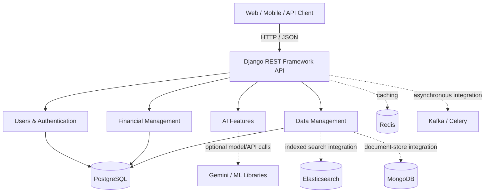
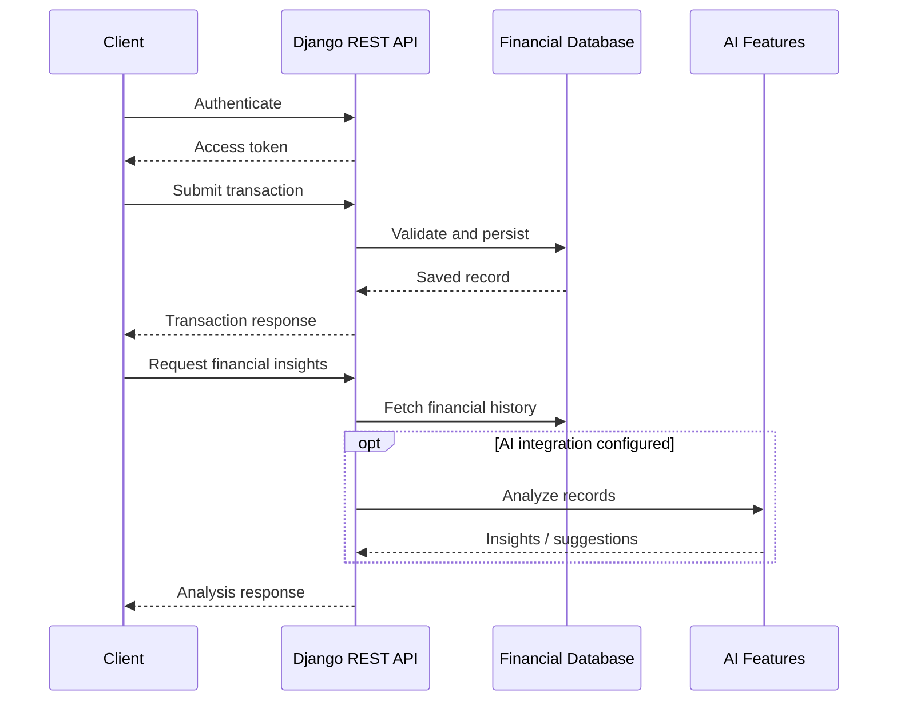

<div align="center">

# FinSight AI
### AI-Powered Financial Intelligence & Management Backend

**Financial management · Intelligent analytics · Secure APIs · Extensible infrastructure**

[](https://www.python.org/)
[](https://www.djangoproject.com/)
[](https://www.django-rest-framework.org/)
[](https://www.postgresql.org/)
[](https://redis.io/)
[](https://www.docker.com/)

[Overview](#overview) · [Features](#features) · [Architecture](#system-architecture) · [Getting Started](#getting-started) · [API](#api-overview) · [Roadmap](#roadmap)

</div>

---

## Overview

**FinSight AI** is a backend-oriented financial management project designed to support account and transaction management, budgeting, expense analysis, reporting, and AI-assisted financial insights. It exposes REST APIs for use by a web dashboard, mobile application, or other client.

The codebase uses **Django** and **Django REST Framework** and includes dedicated modules for **financial operations**, **users**, **AI features**, and **data management**. The repository also provides sample environment configuration, API documentation, and a multi-service Docker Compose setup.

> **Project scope:** Some advanced capabilities are described in the original project documentation or represented by dependencies and infrastructure configuration, but have not been independently verified through running the application. Treat claims about bank synchronization, end-to-end encryption, automated investing, production-ready MFA, and real-time forecasting as **planned or needing verification** unless you have confirmed them in code and tests.

## Features

| Area | Documented capabilities |
|---|---|
| **Accounts & transactions** | Account creation, transaction tracking, income and expense records |
| **Budget management** | Create budgets and analyze spending against categories |
| **Financial analytics** | Summaries, category breakdowns, historical trends, and reporting endpoints |
| **Authentication** | Registration and login endpoints with documented JWT authentication |
| **AI integration** | AI recommendation, insight, analysis, and prediction API concepts; Gemini and ML dependencies are included |
| **Data management** | Import/export and visualization API concepts |
| **Infrastructure** | Dockerized services, PostgreSQL, Redis, MongoDB, Kafka, Elasticsearch, and Nginx configuration |

### Example workflow

1. A user signs in and receives an access token.
2. The client creates or retrieves account and transaction records.
3. Budget and analysis endpoints summarize financial activity.
4. AI-feature endpoints can be used to request additional insights, subject to integration configuration.
5. A client dashboard displays totals and trends; **this repository is primarily a backend, not a verified frontend application**.

## System Architecture

The following is a **conceptual view of the configured stack**, not a claim that every service is required for every API request.



### Transaction-to-insight flow



## Technology Stack

| Layer | Technologies found in repository files |
|---|---|
| Backend | Python, Django 5.0.2, Django REST Framework 3.14.0 |
| Authentication | Simple JWT, Django authentication packages, optional OTP/2FA dependencies |
| Primary database | PostgreSQL / psycopg2 |
| Supporting data services | MongoDB, Elasticsearch |
| Cache & background tasks | Redis, Celery |
| Event infrastructure | Kafka |
| AI / data science | Google Generative AI, LangChain, TensorFlow, PyTorch, scikit-learn, pandas, NumPy, Transformers |
| Documentation & tests | drf-yasg, pytest, Django test runner |
| Containerization | Docker, Docker Compose, Nginx configuration |

> Not every installed or configured library is necessarily wired into a working production feature.

## Repository Structure

```text
financial-backend/
├── ai_features/         # AI-related application code
├── data_management/     # Data import/export and analysis modules
├── finances/            # Financial-domain application
├── financial/           # Django project configuration
├── users/               # User and authentication application
├── services/
│   └── migrations/      # Service-level migrations
├── nginx/
│   └── conf.d/          # Reverse-proxy configuration
├── .env.example         # Sample environment settings
├── API_DOCUMENTATION.md # Extended endpoint examples
├── Dockerfile
├── docker-compose.yml
├── manage.py
├── requirements.txt
└── README.md
```

## Getting Started

### Prerequisites

- Python with a compatible virtual environment
- PostgreSQL for the configured relational database
- Git
- Docker / Docker Compose if running the configured services in containers
- Optional API credentials for external AI providers

### Option 1 — Local development

```bash
git clone https://github.com/purav-12345/FinSight-AI.git
cd financial-backend

python -m venv .venv
# macOS / Linux
source .venv/bin/activate
# Windows PowerShell: .venv\Scripts\Activate.ps1

python -m pip install -r requirements.txt
cp .env.example .env
```

On Windows, copy `.env.example` to `.env` using your shell or file explorer.

Open `.env` and configure at least the Django secret, allowed hosts, database connection, and any enabled optional services. **Replace all placeholder credentials.** The provided example includes additional Redis, Celery, email, and AI variables; their actual use depends on the loaded Django settings.

```bash
python manage.py migrate
python manage.py runserver
```

> **Compatibility note:** The dependency list contains potentially conflicting duplicate version pins (notably `langchain`) and a mix of platform-specific packages. If installation fails, resolve the requirements and test a compatible Python version before treating the environment as reproducible.

### Option 2 — Docker Compose

The repository includes a Compose file defining the web service and supporting infrastructure. Review its development credentials and resource requirements before starting it.

```bash
git clone https://github.com/purav-12345/FinSight-AI.git
cd financial-backend
cp .env.example .env
# Edit .env with non-default local credentials

docker compose up --build
```

The Compose web service publishes port **8000**. The included development command uses Django's `runserver`.

### Basic checks

```bash
python manage.py check
python manage.py test
```

Tests and commands are documented for developer convenience; successful execution has not been verified in this README review.

## API Overview

The following routes are **documented in the repository**. Check `financial/urls.py` and app URL modules for the exact currently registered routes before relying on them in a deployed environment.

| Method | Endpoint | Purpose |
|---|---|---|
| `POST` | `/api/auth/register/` | Create an account |
| `POST` | `/api/auth/login/` | Authenticate user |
| `POST` | `/api/auth/logout/` | End session (as documented) |
| `POST` | `/api/auth/refresh/` | Refresh token (as documented) |
| `GET` | `/api/users/profile/` | Retrieve profile |
| `GET`, `POST` | `/api/finances/accounts/` | List/create accounts |
| `GET`, `POST` | `/api/finances/transactions/` | List/create transactions |
| `GET`, `POST` | `/api/finances/budgets/` | List/create budgets |
| `GET` | `/api/finances/categories/` | List categories |
| `GET` | `/api/ai/insights/` | Retrieve AI insights |
| `GET` | `/api/ai/recommendations/` | Retrieve recommendations |
| `POST` | `/api/ai/analyze/` | Request analysis |
| `GET`, `POST` | `/api/data/exports/` | List/create exports |

### Authentication example

```bash
curl -X POST http://127.0.0.1:8000/api/auth/login/ \
  -H 'Content-Type: application/json' \
  -d '{"email":"user@example.com","password":"your-password"}'
```

### Authorized request example

```bash
curl http://127.0.0.1:8000/api/finances/transactions/ \
  -H 'Authorization: Bearer YOUR_ACCESS_TOKEN'
```

> The JSON shapes and token names may vary with the active serializers and authentication settings. Refer to the existing API documentation, then confirm against the running application.

## Data & Analytics

The repository's API documentation provides examples of financial summaries including total income, expenses, net changes, category-level allocations, and daily totals. These outputs are useful for client-side visuals such as:

- Income vs. expenses over time
- Category-level spending distribution
- Budget vs. actual spending
- Account activity and financial trends

The **visual charts themselves belong in a connected frontend**; this backend README does not imply a ready-made UI is included.

## Security & Production Readiness

Financial records are sensitive. Before deploying this project:

- Set `DEBUG=False`, use a strong `SECRET_KEY`, and configure hosts/CORS appropriately.
- Store credentials only in environment variables or a managed secrets system.
- Enforce HTTPS, secure cookies, token lifetimes, authorization, and input validation.
- Replace development database credentials and lock down exposed database/service ports.
- Review authentication and role-based permissions for each financial record.
- Add automated tests, audit logging, backups, dependency vulnerability checks, and monitoring.
- Independently verify any advertised encryption, 2FA, bank connections, or AI recommendations before describing them as production-ready.

**Disclaimer:** This is a software engineering project. Generated financial insights are not professional financial advice.

## Testing

```bash
python manage.py test
# Or, when the pytest configuration is compatible:
pytest
```

Recommended coverage includes authentication, cross-user authorization, financial data validation, budget calculations, and behavior when external AI APIs are unavailable.

## Roadmap

- [ ] Validate and document the actually registered API routes
- [ ] Resolve dependency conflicts and add a reproducible lockfile
- [ ] Add OpenAPI examples and a Postman collection
- [ ] Expand tests for transaction and budget edge cases
- [ ] Benchmark analytics endpoints and caching
- [ ] Add a frontend dashboard with real screenshots
- [ ] Harden container configuration and CI/CD
- [ ] Evaluate AI outputs and guard against misleading financial recommendations

<div align="center">

**FinSight AI — turning financial data into usable insights.**

</div>
